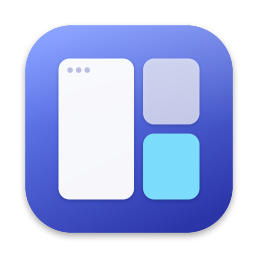

  

# MWM #

**Mac Window Manager**: move, resize and focus windows with the keyboard. A menu bar app for macOS 12 and later, and a fork of [Slate](https://github.com/jigish/slate) by Jigish Patel (same license).

**[Website](https://bbarbosa85.github.io/mwm/)** · **[Download](https://bbarbosa85.github.io/mwm/#download)** · **[Features](https://bbarbosa85.github.io/mwm/features.html)** · **[Documentation](https://bbarbosa85.github.io/mwm/docs.html)** · **[Examples](https://bbarbosa85.github.io/mwm/examples.html)** · **[Releases](https://github.com/bbarbosa85/mwm/releases)** · **[Report an issue](https://github.com/bbarbosa85/mwm/issues/new)**

## What it does ##

* **Shortcuts for windows**: move a window to a slot (halves, thirds, your own areas), push it to an edge, throw it to another screen, focus an app, or nudge and resize by a step.
* **A Settings window instead of a config language**: see every shortcut on a keyboard map, edit it with a form, draw slots by dragging, name your screens, and check for conflicts as you type.
* **Profiles**: keep one per desk or computer, switch between them, and sync them with a private GitHub gist.
* **Snapshots**: save where every window is and put it all back with one shortcut.
* **Window hints**, a screen **grid** and an app **switcher** (beta) for finding and placing windows by letter or by picture.

## Install ##

Download the `.dmg` from the [website](https://bbarbosa85.github.io/mwm/#download), drag **MWM** to **Applications**, and turn MWM on under **System Settings > Privacy & Security > Accessibility** so it can move other apps' windows. The app is signed but not notarized, so macOS asks you to confirm the first launch ([quick start](https://bbarbosa85.github.io/mwm/docs.html#quick-start)). After that, **Check for Updates…** in the menu bar installs new versions.

## Settings and profiles ##

Open **Settings…** from the menu bar. Settings are plain files in `~/.mwm` (for example `~/.mwm/default.mwm.yaml`): one per profile, never code, edited with the window or by hand. An existing `~/.mwm.yml` moves in the first time, and a Slate `.slate` is imported without being changed. See [docs/configuration-yaml.md](docs/configuration-yaml.md) for the format.

## Documentation ##

| Read | For |
|:-----|:----|
| [Website docs](https://bbarbosa85.github.io/mwm/docs.html) | How to use each part of MWM, step by step |
| [Examples](https://bbarbosa85.github.io/mwm/examples.html) | Ready-made profiles to download |
| [docs/configuration-yaml.md](docs/configuration-yaml.md) | Profiles: the file format, the Settings window, sync, migration |
| [docs/operations-reference.md](docs/operations-reference.md) | Every operation a shortcut can run |
| [docs/configuration-slate.md](docs/configuration-slate.md) | The classic `.slate` directives, expressions and allowed keys |
| [docs/ui-and-overlays.md](docs/ui-and-overlays.md) | The grid, window hints, app switcher and Settings window |
| [docs/architecture.md](docs/architecture.md) · [docs/codebase-walkthrough.md](docs/codebase-walkthrough.md) | How MWM is built |
| [docs/permissions-and-codesigning.md](docs/permissions-and-codesigning.md) | Accessibility permission and code signing |
| [docs/releasing.md](docs/releasing.md) · [docs/roadmap.md](docs/roadmap.md) | Cutting a release, and what is planned |

The full index is in [docs/README.md](docs/README.md).

## Building ##

Open `MWM.xcodeproj` in Xcode, or run `script/check` to build and run the tests the way CI does (about a minute). See [docs/releasing.md](docs/releasing.md) for releases.

## Credits and contact ##

Thanks to Jigish Patel for Slate, and to [philc](https://github.com/philc) for the Window Hints idea and first implementation. Questions, bug reports and ideas: [open an issue](https://github.com/bbarbosa85/mwm/issues/new). Released under the [GNU GPL v3](LICENSE).
