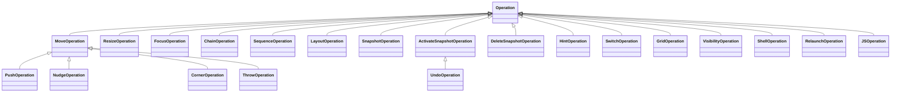

# Comprehensive Operations Reference

Operations are the core executable commands in Slate. They can be triggered by key bindings (`bind`), sequenced in `sequence` or `chain`, grouped into `layout` files, or executed programmatically via JavaScript.



---

## 1. Geometry & Positioning Operations

### `move`
Moves and resizes the focused window to explicit coordinates and dimensions.
- **Classic Syntax**: `move topLeftX;topLeftY sizeX;sizeY [screen]`
- **JS Syntax**: `slate.operation("move", { x: ..., y: ..., width: ..., height: ..., screen: ... })`
- **Options**:
  - `x`, `y`: Target top-left coordinate (can be an expression).
  - `width`, `height`: Target dimensions (can be an expression).
  - `screen`: Screen index, resolution, or relative direction (default: current screen).

```
# Center a 1200x800 window on the current screen
bind m:ctrl;cmd move screenOriginX+(screenSizeX-1200)/2;screenOriginY+(screenSizeY-800)/2 1200;800
```

---

### `push`
Snaps a window against a display boundary with optional bar or center styling.
- **Classic Syntax**: `push direction [style] [screen]`
- **JS Syntax**: `slate.operation("push", { direction: ..., style: ..., screen: ... })`
- **Parameters**:
  - `direction`: `top` (`up`), `bottom` (`down`), `left`, `right`.
  - `style`:
    - `none`: Aligns window to edge keeping its current size.
    - `center`: Centers window along the axis orthogonal to push direction.
    - `bar`: Expands window across the entire length of the chosen edge.
    - `bar-resize:<expr>`: Expands window across edge and sets width/height according to expression (e.g. `bar-resize:screenSizeX/2`).
  - `screen`: Target screen identifier.

```
# Left half of display
bind left:ctrl;cmd push left bar-resize:screenSizeX/2

# Right half of display
bind right:ctrl;cmd push right bar-resize:screenSizeX/2

# Top third
bind up:ctrl;cmd push up bar-resize:screenSizeY/3
```

---

### `resize`
Alters window width and height relative to its current dimensions anchored to a specific corner.
- **Classic Syntax**: `resize x y [anchor]`
- **JS Syntax**: `slate.operation("resize", { x: ..., y: ..., anchor: ... })`
- **Parameters**:
  - `x`: Delta width (pixels like `+50`, `-100`, or percent like `+10%`, `-5%`).
  - `y`: Delta height (pixels or percent).
  - `anchor`: `top-left` (default), `top-right`, `bottom-left`, `bottom-right`.

```
# Expand rightward by 10%
bind right:alt resize +10% +0

# Shrink bottom-right anchored from bottom-right
bind left:ctrl;alt resize -10% +0 bottom-right
```

---

### `nudge`
Shifts the position of a window without modifying its dimensions.
- **Classic Syntax**: `nudge x y`
- **JS Syntax**: `slate.operation("nudge", { x: ..., y: ... })`
- **Parameters**:
  - `x`: Delta X offset (`+50`, `-50`, or `+10%`).
  - `y`: Delta Y offset.

```
bind left:shift;alt nudge -10% +0
bind right:shift;alt nudge +10% +0
bind up:shift;alt nudge +0 -10%
bind down:shift;alt nudge +0 +10%
```

---

### `corner`
Snaps window into one of the four screen corners.
- **Classic Syntax**: `corner direction [style] [screen]`
- **JS Syntax**: `slate.operation("corner", { direction: ..., width: ..., height: ..., screen: ... })`
- **Parameters**:
  - `direction`: `top-left`, `top-right`, `bottom-left`, `bottom-right`.
  - `style`: `resize:<x-expr>;<y-expr>` (e.g. `resize:screenSizeX/2;screenSizeY/2`).

```
bind 1:ctrl;cmd corner top-left resize:screenSizeX/2;screenSizeY/2
bind 2:ctrl;cmd corner top-right resize:screenSizeX/2;screenSizeY/2
bind 3:ctrl;cmd corner bottom-left resize:screenSizeX/2;screenSizeY/2
bind 4:ctrl;cmd corner bottom-right resize:screenSizeX/2;screenSizeY/2
```

---

### `throw`
Moves a window to another monitor, optionally scaling it.
- **Classic Syntax**: `throw screen [style]`
- **JS Syntax**: `slate.operation("throw", { screen: ..., style: ..., width: ..., height: ... })`
- **Parameters**:
  - `screen`: Screen index (`0`, `1`), direction (`left`, `right`, `above`, `below`), or `next` / `previous`.
  - `style`: `noresize` (default), `resize` (maximize to new monitor), or `resize:<width-expr>;<height-expr>`.

```
# Move window to next monitor preserving relative position
bind right:ctrl;alt;cmd throw next

# Move window to monitor 1 and expand to fill
bind 1:ctrl;alt throw 0 resize
```

---

## 2. Window Focus & Navigation Operations

### `focus`
Transfers keyboard and window focus based on spatial direction or application name.
- **Classic Syntax**: `focus direction|'AppName'`
- **JS Syntax**: `slate.operation("focus", { direction: ... })` or `slate.operation("focus", { app: ... })`
- **Directions**: `left`, `right`, `up` (`above`), `down` (`below`), `behind`.

```
bind left:cmd focus left
bind right:cmd focus right
bind up:cmd;alt focus behind
bind c:ctrl;cmd focus 'Google Chrome'
```

---

### `hint`
Displays visual letter badges over all open windows on the screen (Vimium-style) for direct, one-key window focusing.
- **Classic Syntax**: `hint [characters]`
- **JS Syntax**: `slate.operation("hint", { characters: ... })`

```
bind esc:cmd hint
bind esc:ctrl;cmd hint ASDFGHJKLQWERTYUIOP
```

---

### `switch`
Activates Slate's enhanced keyboard application switcher.
- **Classic Syntax**: `switch`
- **JS Syntax**: `slate.operation("switch")`

When replacing macOS's built-in application switcher (`bind tab:cmd switch`), Slate displays an interactive horizontal or vertical HUD with hotkey quit (`q`), force quit (`f`), hide (`h`), and reverse navigation (`` ` ``).

---

## 3. Orchestration & Meta-Operations

### `chain`
Cycles through an array of operations on successive presses of the same hotkey.
- **Classic Syntax**: `chain op1 | op2 | op3 ...`
- **JS Syntax**: `slate.operation("chain", { operations: [op1, op2] })`

```
# Toggle window between left half, right half, and maximized
bind space:ctrl;cmd chain push left bar-resize:screenSizeX/2 | push right bar-resize:screenSizeX/2 | move screenOriginX;screenOriginY screenSizeX;screenSizeY
```

---

### `sequence`
Executes multiple operations simultaneously in a single keystroke.
- **Classic Syntax**: `sequence op1 separator op2 ...`
  - `|`: Next operation executes on window focused at that instant.
  - `>`: Next operation executes on window focused at start of `>` chain.
- **JS Syntax**: `slate.operation("sequence", { operations: [op1, op2] })`

```
# Focus the right window, then arrange windows side-by-side
bind 1:ctrl;cmd sequence focus right > push left | push right
```

---

### `layout`
Applies a named preset layout across all active displays and applications.
- **Classic Syntax**: `layout layoutName`
- **JS Syntax**: `slate.operation("layout", { name: "layoutName" })`

---

## 4. State Persistence & Undo

### `snapshot`, `activate-snapshot`, `delete-snapshot`
Saves, activates, and clears snapshots of window geometries across all displays.
- `snapshot name [save-to-disk;stack]`
- `activate-snapshot name [delete]`
- `delete-snapshot name [all]`

```
# Save snapshot to persistent storage
bind s:ctrl;cmd snapshot workState save-to-disk

# Restore snapshot
bind a:ctrl;cmd activate-snapshot workState
```

### `undo`
Reverts the last window movement operation using Slate's internal undo stack (`UNDO_SNAPSHOT`).
- **Classic Syntax**: `undo`
- **JS Syntax**: `slate.operation("undo")`

```
bind z:ctrl;cmd undo
```

---

## 5. System & Utility Operations

### `shell`
Executes an arbitrary shell command.
- **Classic Syntax**: `shell [options] 'command'`
- **Options**: `wait` (blocks Slate until command finishes), `path:<dir>` (working directory).
- **JS Syntax**: `slate.shell(command, wait, path)`

```
bind t:ctrl;cmd shell path:~/ 'open -a Terminal .'
```

### `hide`, `show`, `toggle`
Manipulates application visibility.
- **Syntax**: `hide|show|toggle 'AppName'|current|all|all-but:'AppName'`

```
# Toggle iTunes/Music visibility
bind m:ctrl;cmd toggle 'Music'
```

### `relaunch`
Restarts Slate and reloads all configuration files from scratch.
- **Syntax**: `relaunch`

```
bind r:ctrl;cmd relaunch
```

